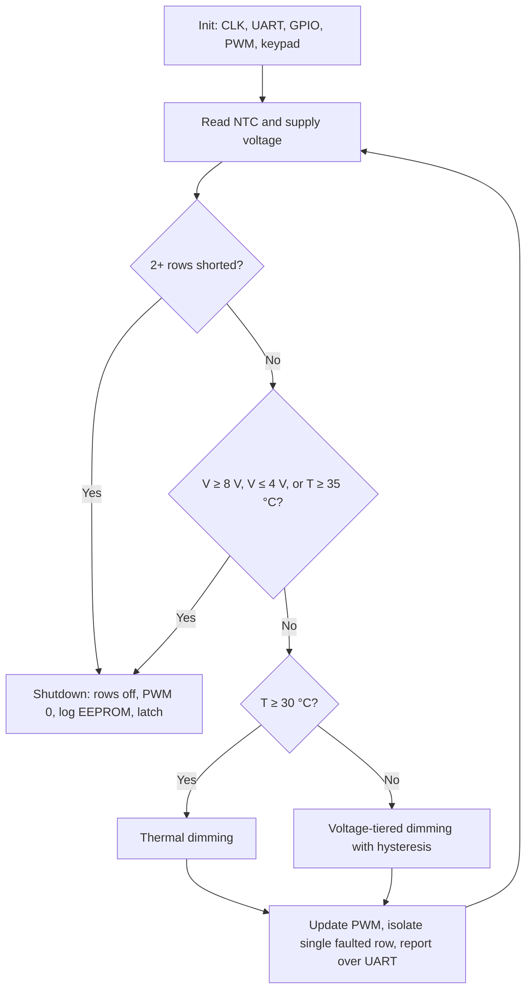

# Automotive LED Lighting ECU — Functional Safety & Self-Diagnostics

Prototype **Electronic Control Unit (ECU)** for an automotive LED lamp, built on a **PIC18F45K50**. It monitors supply voltage, temperature and per-row short circuits in real time, dims or shuts down the LEDs to protect the hardware, and logs every fault to on-chip EEPROM so the history survives power cycles.

Developed for the **OPmobility** challenge in *TC2009B – Design Based on Microcontrollers and Computer Architecture* at Tecnológico de Monterrey (Aug–Dec 2025).

> 🎥 **Demo:** [Functional prototype demonstration](LINK_TO_VIDEO)
> 📄 **Technical report (Spanish):** [`docs/Reporte_Tecnico.pdf`](docs/Reporte_Tecnico.pdf)

---

## Features

| Feature | Behavior |
|---|---|
| **Over-voltage shutdown** | Supply ≥ 8.0 V → all rows off, PWM to 0, fault logged, system latched |
| **Under-voltage shutdown** | Supply ≤ 4.0 V → same latched shutdown |
| **Over-temperature shutdown** | NTC ≥ 35 °C → same latched shutdown |
| **Thermal dimming** | NTC ≥ 30 °C → PWM duty reduced (1023 → 600) |
| **Voltage-based dimming** | ≥ 6 V → duty 800, ≥ 7 V → duty 600, with 150 mV hysteresis to prevent chatter |
| **Short-circuit detection** | Per-row fault inputs; 1 faulted row is isolated and the lamp keeps running, **2+ rows → full shutdown** |
| **Persistent fault log** | Fault counters in internal EEPROM, viewable and clearable from the menu |
| **Live telemetry** | Temperature, voltage and PWM duty streamed over UART |
| **Keypad HMI** | 4×4 matrix keypad for menu navigation and per-row ON/OFF control |

Safety checks run continuously, **including while the system is waiting for a keypress**, so no menu state can leave the hardware unprotected.

---

## Hardware

| Component | Part | Role |
|---|---|---|
| MCU | PIC18F45K50 (Curiosity HPC board) | Control, ADC, PWM, UART, EEPROM |
| Power switch | IRFZ44N N-MOSFET | Main PWM dimming / emergency cutoff for the LED array |
| Row drivers | 2N2222A BJT ×4 | Independent ON/OFF per LED row |
| Temperature sensor | 10 kΩ NTC thermistor (β = 3950) + 10 kΩ fixed resistor | Thermal monitoring |
| Voltage sense | 9.9 kΩ / 6.86 kΩ resistive divider | Maps 0–12 V supply into the 0–5 V ADC range |
| User input | 4×4 matrix keypad | Menu / HMI |
| Serial bridge | FTDI USB-UART module | Telemetry to PC |
| Fault injection | Switches on RA4–RA7 | Simulate shorts on each row |
| Load | Red LEDs (4 rows) | Simulated tail-light / headlamp |

### Pinout

| Pin | Direction | Function |
|---|---|---|
| RA0–RA3 | Out | LED row enables (Row 1–4) |
| RA4–RA7 | In (active-low) | Short-circuit fault switches, rows 1–4 |
| RB4–RB7 | Out | Keypad column scan |
| RB0–RB3 | In (weak pull-ups) | Keypad row read |
| RC1 (CCP2) | Out | PWM to MOSFET gate driver |
| RC6 / RC7 | Out / In | UART TX / RX |
| RE0 (AN5) | Analog | NTC thermistor |
| RE1 (AN6) | Analog | Supply voltage divider |

---

## Firmware Architecture

### Peripheral configuration

- **Clock:** internal HFINTOSC at 16 MHz
- **ADC:** 10-bit, 5 V reference (≈ 4.89 mV/LSB), right-justified, F<sub>OSC</sub>/32; voltage reading averages 8 samples
- **PWM:** CCP2 on Timer2 (prescaler 1:4, PR2 = 124)
- **EUSART:** asynchronous, 8N1, BRGH = 1, BRG16 = 1, ≈ 9600 baud
- **EEPROM:** fault counters at addresses `0x00`–`0x03`

### Sensor conversion

**Voltage** — divider factor plus an empirical correction of 0.9 determined during calibration:

```
V_in = V_pin × (R_top + R_bottom) / R_bottom × 0.9
```

**Temperature** — β-parameter model:

```
R_ntc = V_adc × R_fixed / (V_DD − V_adc)
1/T   = 1/T₂₅ + (1/β) · ln(R_ntc / R₂₅)
```

### Control loop



A shutdown is **latched**: the MCU stays in a safe-state loop until it is reset, so a fault can never clear itself silently.

### EEPROM fault map

| Address | Counter |
|---|---|
| `0x00` | Multiple short-circuit events |
| `0x01` | Over-voltage events |
| `0x02` | Under-voltage events |
| `0x03` | Over-temperature events |

Erased cells (`0xFF`) are treated as zero.

---

## Usage

Connect the FTDI module and open a serial terminal (e.g. MPLAB Data Visualizer, PuTTY) at **9600 baud, 8N1**.

```
========== MENU ==========
1) MODO MONITOREO
2) Encender Lineas
3) Apagar Lineas
4) HISTORIAL FALLAS
===============================
```

| Key | Action |
|---|---|
| `1` | Live monitoring: prints `T:<°C> V:<V> PWM:<duty>` and reports short events per row. `*` to exit |
| `2` → `1–4` | Turn a row on |
| `3` → `1–4` | Turn a row off |
| `4` | Show EEPROM fault history. `*` back, `C` clears all counters |

> Terminal output is in Spanish.

---

## Building

**Toolchain:** MPLAB X IDE + XC8 compiler. Programmed and debugged on the Curiosity HPC board.

1. Clone the repo and open it as an MPLAB X project (or create a new PIC18F45K50 project and add the sources).
2. Make sure `main.h` sets the configuration bits for the internal oscillator.
3. Build and program via the onboard debugger.

### Calibration constants

Adjust these in `main.c` to match your components:

```c
#define R_TOP_K       9.9      // divider top resistor (kΩ)
#define R_BOTTOM_K    6.86     // divider bottom resistor (kΩ)
#define V_CORRECTION  0.9      // empirical ADC correction
#define NTC_BETA      3950.0
#define NTC_R25       10900.0  // measured NTC resistance at 25 °C
#define R_FIXED       10000.0
```

---

## Testing

**Unit tests**

| Peripheral | Test | Result |
|---|---|---|
| ADC (voltage) | Sweep supply 3–9 V, compare UART reading | < 5 % error after 0.9 correction factor |
| PWM | Change duty 1023 → 600 | Visible brightness reduction |
| EEPROM | Write `0x00`, reset MCU, read back | Value persisted |

**Integration tests**

| Scenario | Stimulus | Result |
|---|---|---|
| Over-voltage | Raise supply to 8.1 V | LEDs off, fault logged, UART alert |
| Under-voltage | Drop supply below 4 V | Shutdown at 3922 mV reading, fault logged |
| Over-temperature | Heat NTC | Shutdown when crossing 35 °C, fault logged |
| Multiple shorts | Close RA4 + RA5 switches | Full shutdown on 2+ faulted rows |

---

## Limitations & Future Work

- Vehicle bus communication is simulated over UART; a real **CAN or LIN** interface is the next step.
- Short circuits are simulated with switches; real detection would use current sensing or a **smart high-side switch** with built-in diagnostics.
- The resistive divider draws a small constant quiescent current.
- Temperature accuracy depends on NTC β calibration; a digital sensor would improve precision.

---

## Authors

- **Moisés Arturo Flores Cayón**
- **Armando Gordillo Ramírez**
- **Juan Pablo Bastián Gutiérrez**

Tecnológico de Monterrey, Campus Monterrey — TC2009B.601, in collaboration with **OPmobility**.
